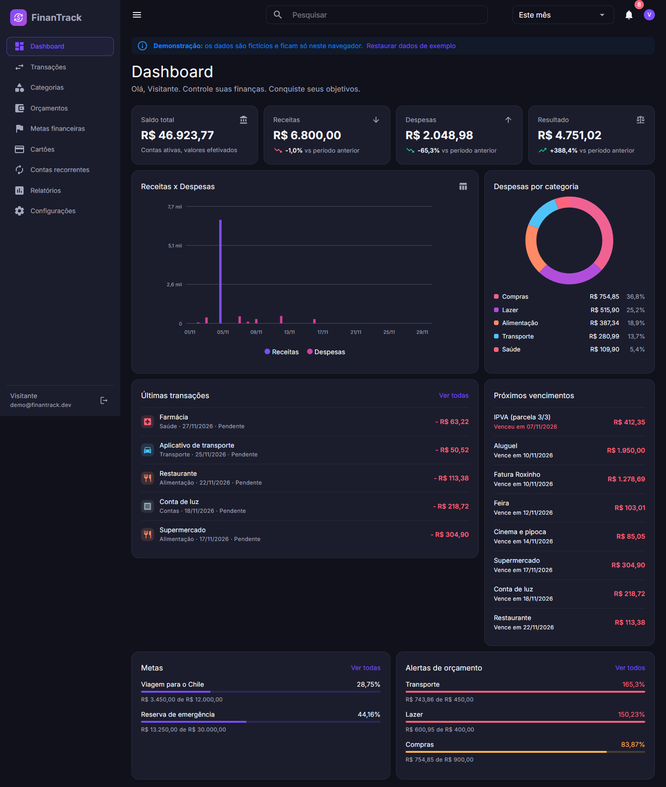
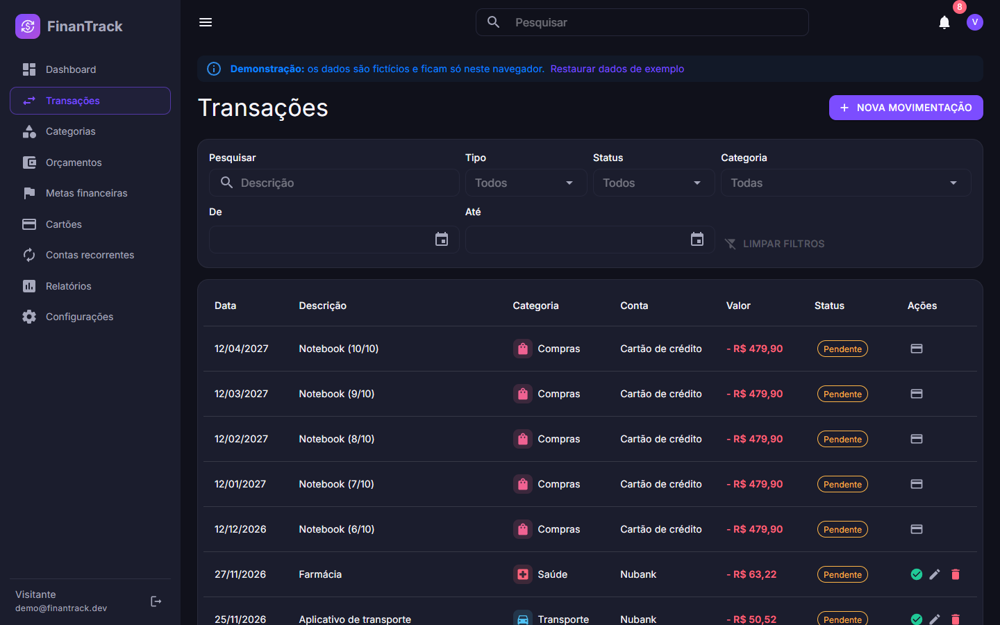
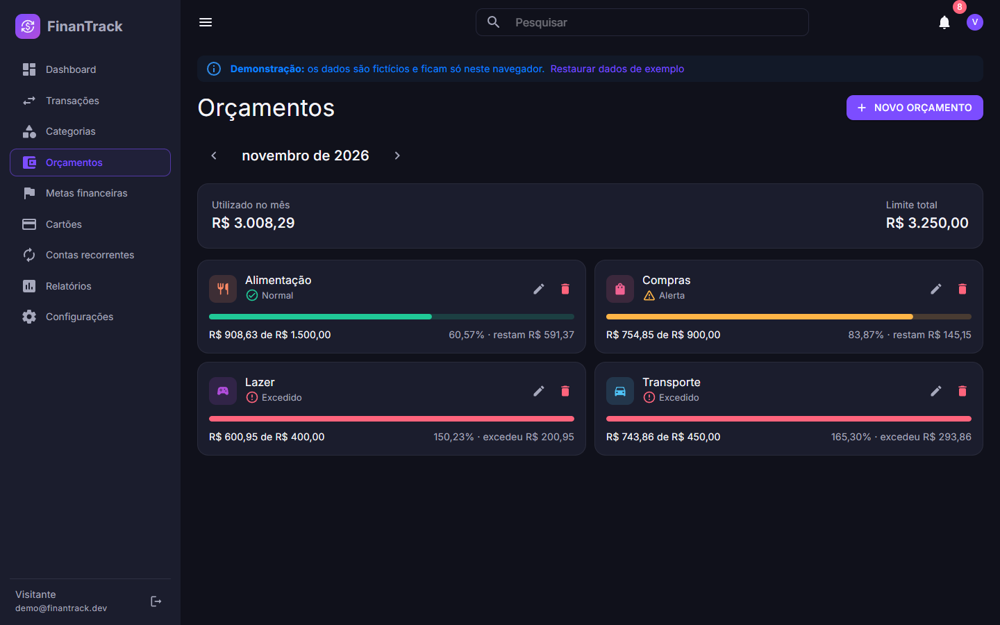
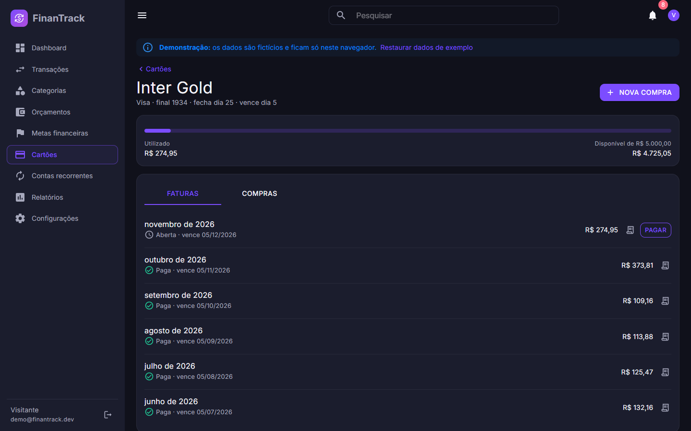
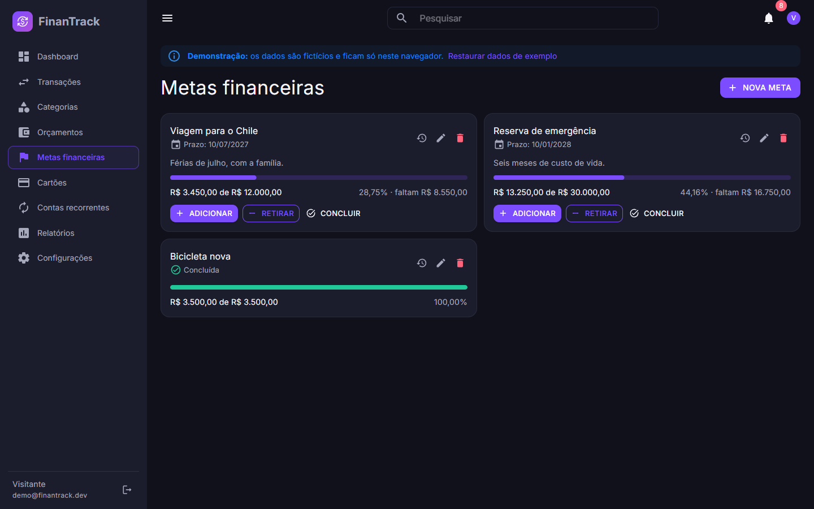
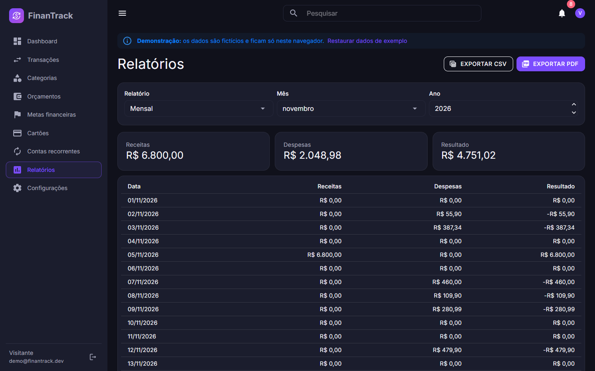
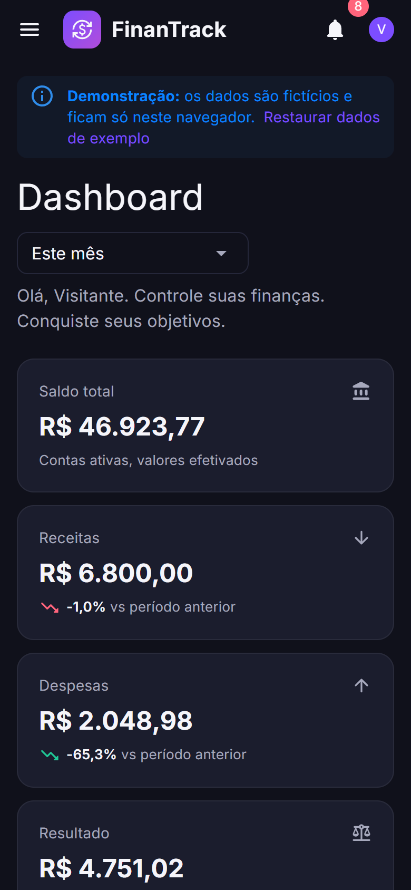
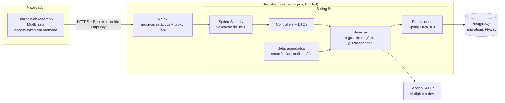

# FinanTrack

> **Controle suas finanças. Conquiste seus objetivos.**

[](https://github.com/r00mul00/FinanTrack/actions/workflows/ci.yml)
[](https://r00mul00.github.io/FinanTrack/)
[](LICENSE)

Aplicação web de finanças pessoais: contas, transações, categorias, orçamentos, metas, cartões de crédito com faturas parceladas, contas recorrentes, dashboard e relatórios. O backend é uma API REST em **Java 21 + Spring Boot**, e o frontend é uma SPA em **C# + Blazor WebAssembly**.

### ▶ [Abrir a demonstração](https://r00mul00.github.io/FinanTrack/)

A demonstração roda inteira no navegador, com **dados fictícios** que ficam só no seu dispositivo. Entre com qualquer e-mail e senha. Detalhes em [Demonstração e sistema completo](#demonstração-e-sistema-completo).



---

## Sumário

- [Funcionalidades](#funcionalidades)
- [Telas](#telas)
- [Tecnologias](#tecnologias)
- [Arquitetura](#arquitetura)
- [Como executar](#como-executar)
- [Testes](#testes)
- [Demonstração e sistema completo](#demonstração-e-sistema-completo)
- [Documentação](#documentação)
- [Licença](#licença)

## Funcionalidades

| Área | O que faz |
|---|---|
| **Conta e segurança** | Cadastro com verificação de e-mail, login com JWT de curta duração, refresh token rotativo em cookie HttpOnly, recuperação de senha, troca de e-mail, limite de tentativas e exportação dos dados pessoais (LGPD) |
| **Transações** | Receitas e despesas pendentes ou efetivadas, com filtros, ordenação, paginação e controle de concorrência otimista |
| **Contas e categorias** | Saldo calculado a partir do efetivado; categorias com ícone e cor. Excluir uma categoria em uso exige escolher outra para receber os registros |
| **Orçamentos** | Limite mensal por categoria, com alerta a partir de 80% e aviso de excesso |
| **Metas** | Aportes, retiradas, histórico e progresso, com conclusão manual |
| **Cartões de crédito** | Compras parceladas distribuídas nas faturas pelo dia de fechamento, limite disponível, pagamento parcial ou total da fatura |
| **Contas recorrentes** | Semanais a anuais, geradas por job agendado, com pausa e retomada |
| **Dashboard** | Saldo, receitas, despesas e resultado comparados ao período anterior, gráficos e próximos vencimentos |
| **Relatórios** | Mensal, anual, por categoria, por período, por cartão e evolução, com exportação em CSV e PDF |
| **Outros** | Busca global, notificações, tema claro e escuro, auditoria das alterações e layout responsivo |

As regras financeiras estão em [docs/06-regras-financeiras.md](docs/06-regras-financeiras.md). Exemplos: a compra no cartão conta como despesa na data da compra, e não no pagamento da fatura; a receita só conta depois de recebida; o orçamento mede o comprometido, incluindo os gastos pendentes.

## Telas

| | |
|---|---|
|  |  |
| **Transações**: filtros, ordenação e ações por linha | **Orçamentos**: estados normal, alerta e excedido |
|  |  |
| **Cartão**: faturas abertas, pagas e limite em uso | **Metas**: progresso, aportes e retiradas |
|  |  |
| **Relatórios**: indicadores, tabela e exportação | **Celular**: layout responsivo |

Todas as telas usam os dados fictícios da demonstração.

## Tecnologias

| Camada | Tecnologias |
|---|---|
| **Backend** | Java 21, Spring Boot 4, Spring Security, Spring Data JPA, Bean Validation, Flyway, MapStruct, springdoc-openapi (Swagger), OpenPDF |
| **Frontend** | .NET 10, Blazor WebAssembly, MudBlazor |
| **Banco** | PostgreSQL 17, versionado com migrations do Flyway |
| **Infra** | Docker (imagens de produção da API e do Nginx), Docker Compose, GitHub Actions (CI, varredura de segredos com gitleaks e publicação no GitHub Pages) |
| **Testes** | JUnit 5, Spring Boot Test, MockMvc, AssertJ |

A justificativa de cada escolha está em [docs/01-arquitetura.md](docs/01-arquitetura.md).

## Arquitetura

Monorepo com `backend/`, `frontend/`, `infra/` e `docs/`. Em produção, o Nginx entrega o frontend e encaminha `/api` para o backend. Assim, tudo fica **na mesma origem**: o cookie do refresh token funciona sem depender de cookies entre sites, e o CORS não é necessário.



O backend é organizado **por módulo de negócio** (`account`, `transaction`, `card`, `budget`, `goal`...). Cada módulo tem controller, service, repository, entidades e DTOs próprios. O diagrama do banco está em [docs/03-banco-de-dados.md](docs/03-banco-de-dados.md), e a autenticação em [docs/05-autenticacao.md](docs/05-autenticacao.md).

## Como executar

### Pré-requisitos

- **Java 21** (o Maven Wrapper já vem no repositório)
- **.NET 10 SDK**
- **PostgreSQL 17**, instalado localmente ou pelo `docker compose` (veja abaixo)
- Opcional: **Docker**, para subir banco e Mailpit, ou para rodar as imagens de produção

### 1. Variáveis de ambiente

```bash
cp .env.example .env
```

Preencha o `.env`: `DB_PASSWORD` e um `JWT_SECRET` aleatório com pelo menos 32 bytes (`openssl rand -base64 48`). O arquivo `.env` nunca é versionado.

### 2. Banco e e-mail

Com Docker, sobe o PostgreSQL e o [Mailpit](https://mailpit.axllent.org/), que recebe os e-mails de desenvolvimento em http://localhost:8025:

```bash
docker compose up -d
```

Sem Docker, crie no PostgreSQL local o usuário e os bancos `finantrack` e `finantrack_test` indicados no `.env`. As tabelas são criadas pelo Flyway ao subir a API.

### 3. API

```bash
cd backend
SPRING_PROFILES_ACTIVE=dev ./mvnw spring-boot:run
```

A API sobe em http://localhost:8080. No perfil `dev`, o **Swagger UI** fica em http://localhost:8080/swagger-ui.html, com descrição, erros possíveis e exemplos de cada operação. Há também um fluxo completo com `curl` em [docs/09](docs/09-exemplos-de-requisicoes.md).

### 4. Frontend

```bash
cd frontend/src/FinanTrack.Web
dotnet run --launch-profile http
```

Abra http://localhost:5080 e crie uma conta. O e-mail de verificação chega ao Mailpit.

### Imagens de produção (Docker)

Para rodar banco, API e Nginx juntos, como em produção:

```bash
sh infra/generate-secrets.sh        # cria o .env.prod com senha e segredo aleatórios
docker compose -f infra/docker-compose.prod.yml --env-file .env.prod up -d --build
sh infra/smoke-test.sh http://localhost:8080
```

No perfil `prod`, a API valida a configuração ao iniciar e não sobe com valores de exemplo, segredos fracos ou endereços sem HTTPS. As variáveis estão documentadas em [.env.prod.example](.env.prod.example).

## Testes

```bash
cd backend
./mvnw verify
```

São **370+ testes** no backend, em 32 classes, rodando contra um PostgreSQL real (banco `finantrack_test`, definido em `TEST_DB_URL`):

- **Integração (MockMvc + Spring Boot Test):** cada módulo é testado pela API HTTP. Os testes cobrem validação, autorização (um usuário nunca acessa dados de outro), códigos de erro e as regras de docs/06, como parcelamento, faturas, orçamentos, recorrências e relatórios.
- **Unitários:** cálculos isolados, como divisão de parcelas, datas de fatura, calendário de recorrências e estados de orçamento.
- **Segurança:** rotação e reuso do refresh token, limite de tentativas, cabeçalhos, CORS e validação da configuração de produção.
- **Performance:** contagem de consultas SQL por requisição, para impedir o problema N+1 nas listagens.

O **CI** (GitHub Actions) roda a cada push e pull request na `main`:

| Job | O que verifica |
|---|---|
| Backend | Build e todos os testes, com PostgreSQL 17 como serviço |
| Frontend | Build do Blazor em Release |
| Imagens de produção | Build das imagens, subida com Docker Compose e teste de fumaça |
| Varredura de segredos | gitleaks em todo o histórico |

## Demonstração e sistema completo

O repositório tem duas linhas:

| | `main` | [`demo/github-pages`](https://github.com/r00mul00/FinanTrack/tree/demo/github-pages) |
|---|---|---|
| **O que é** | O sistema completo: API, banco, e-mails e Docker | Só o frontend, publicado no GitHub Pages |
| **Dados** | PostgreSQL | Fictícios, no `localStorage` do navegador |
| **Onde roda** | Localmente, ou em qualquer host com Docker | https://r00mul00.github.io/FinanTrack/ |

O GitHub Pages serve apenas arquivos estáticos. Por isso, na demonstração, uma camada no navegador substitui a API e reproduz as mesmas regras de negócio. Ficam de fora o envio de e-mails, a troca de senha e a exportação em PDF. O motivo da escolha está em [docs/01-arquitetura.md](docs/01-arquitetura.md#hospedagem-d12).

## Documentação

| Documento | Conteúdo |
|---|---|
| [01 — Arquitetura](docs/01-arquitetura.md) | Visão geral, tecnologias, estilo arquitetural e hospedagem |
| [02 — Estrutura de pastas](docs/02-estrutura-de-pastas.md) | Organização do monorepo e dos módulos |
| [03 — Banco de dados](docs/03-banco-de-dados.md) | Diagrama entidade-relacionamento e tabelas |
| [04 — Endpoints](docs/04-api-endpoints.md) | Rotas da API REST |
| [05 — Autenticação](docs/05-autenticacao.md) | JWT, refresh token e fluxos de e-mail |
| [06 — Regras financeiras](docs/06-regras-financeiras.md) | Cálculos de saldo, faturas, orçamentos e recorrências |
| [07 — Interface](docs/07-interface.md) | Identidade visual e padrões de tela |
| [09 — Exemplos de requisições](docs/09-exemplos-de-requisicoes.md) | Fluxo completo com `curl`, do cadastro ao logout, com respostas reais |
| [Plano de desenvolvimento](PLANO_DESENVOLVIMENTO.md) | Fases, decisões técnicas (D1 a D12) e checklists |

## Licença

Distribuído sob a licença MIT. Veja o arquivo [LICENSE](LICENSE).
