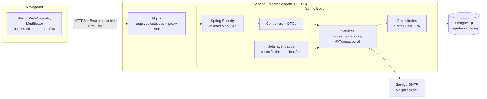

# 01 — Arquitetura

## Visão geral

O FinanTrack é uma SPA em Blazor WebAssembly que consome uma API REST em Spring Boot, com PostgreSQL como banco. O código fica em um monorepo (`backend/`, `frontend/`, `docs/`).

Em produção, um único ponto de entrada (Nginx) entrega o frontend e encaminha `/api` para o backend. Para o navegador, tudo tem **a mesma origem**. Essa escolha resolve D5: o cookie do refresh token funciona sem depender de cookies entre sites, e o CORS deixa de ser necessário em produção.

## Tecnologias e justificativas

Versões verificadas nas fontes oficiais em 2026-11-08.

| Tecnologia | Versão | Por que usar |
|---|---|---|
| Java | 21 (LTS) | Exigido pelo projeto; records, pattern matching e suporte longo |
| Spring Boot | 4.1.2 | Versão estável padrão do Spring Initializr; suporta Java 21 |
| Spring Security + OAuth2 Resource Server | Gerenciado pelo Boot | Validação de JWT oficial, sem biblioteca de terceiros e sem filtro escrito à mão |
| Spring Data JPA / Hibernate | Gerenciado pelo Boot | Repositórios, paginação e bloqueios (`@Version`, `@Lock`) |
| PostgreSQL | 17 | `NUMERIC` exato, restrições `CHECK` e índices parciais, usados nas regras financeiras |
| Flyway | Gerenciado pelo Boot | Banco versionado e reproduzível |
| Bean Validation | Gerenciado pelo Boot | Validação declarativa nos DTOs |
| springdoc-openapi | Linha compatível com Boot 4, confirmar na Fase 2 | Swagger UI gerado a partir do código |
| MapStruct | 1.6.x, confirmar na Fase 2 | Mapeamento gerado em compilação, sem reflexão (dependência extra, fora da stack obrigatória) |
| JUnit 5 + Mockito | Gerenciado pelo Boot | Exigidos pelo projeto |
| Testcontainers | Fase 8, depende do Docker | Testes de integração em PostgreSQL real |
| .NET / Blazor WebAssembly | 10 | SDK 10.0.403 já instalado |
| MudBlazor | 9.12.0 | Versão estável com suporte declarado a `net10.0` |
| Nginx | Fase 9 | Mesma origem para SPA e API |

## Estilo arquitetural

**Monólito modular.** Um único deploy, com código separado por domínio (`transaction`, `card`, `goal`...) e camadas dentro de cada domínio.

| Alternativa | Avaliação |
|---|---|
| Monólito modular | **Escolhida.** Transações de banco simples entre módulos e deploy único, com organização defensável em entrevista |
| Camadas globais (`controllers/`, `services/`...) | Cada funcionalidade fica espalhada; escala mal com 12 módulos |
| Microsserviços | Consistência distribuída sem benefício para um sistema pessoal |

## Princípios transversais

| Tema | Decisão |
|---|---|
| Isolamento | Todo acesso usa `findByIdAndUserId`. O `userId` vem sempre do JWT, nunca do corpo ou da URL |
| Registro de outro usuário | Responde **404**, não 403, para não revelar que o ID existe |
| IDs | UUID nas tabelas expostas |
| Dinheiro | `BigDecimal` / `NUMERIC(14,2)`; arredondamento `HALF_UP` |
| Datas | Datas financeiras em `DATE`; instantes em `TIMESTAMPTZ` (UTC) |
| "Hoje" | Calculado em `America/Sao_Paulo`, em um `Clock` injetável para os testes |
| Erros | Formato RFC 9457 (`application/problem+json`), via `@RestControllerAdvice` |
| Versão da API | Prefixo `/api/v1` |
| Segredos | Somente variáveis de ambiente |
| Concorrência | Ver [regras financeiras](06-regras-financeiras.md#concorrência) |

## Hospedagem (D12)

O requisito técnico está definido: um host que execute containers Docker, atendendo SPA e API no mesmo domínio com HTTPS, e um PostgreSQL gerenciado ou em container. **O provedor específico fica para o início da Fase 9**, porque preços e planos gratuitos mudam e nada no código depende dessa escolha.

**Finalidade (2026-11-10):** portfólio e demonstração, priorizando custo zero. Não é para uso real com dados financeiros pessoais. Isso admite plano gratuito com hibernação, primeira resposta mais lenta e limites de banco.

**Decisão (2026-11-10): duas linhas.** A `main` é o sistema completo (API, banco e Docker), para execução local. A demonstração pública fica no **GitHub Pages**, no subdomínio gratuito (https://r00mul00.github.io/FinanTrack/), publicada a partir da branch `demo/github-pages`. Como o Pages serve só arquivos estáticos, essa branch roda o frontend em modo demonstração: uma camada no navegador substitui a API, reproduz as regras de docs/06 e guarda dados fictícios no `localStorage`. Os detalhes estão no docs/01-arquitetura.md da própria branch.

Consequência: não há deploy público do backend. D5 e os itens de cookies, CORS e domínio continuam válidos para quem executar o sistema completo, mas não há um domínio de produção para configurá-los.
