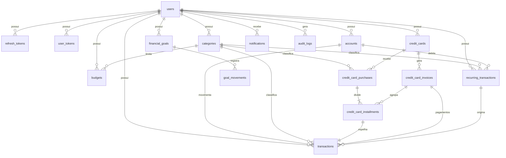

# 03 — Modelagem do banco de dados

## Convenções

- Tabelas e colunas em inglês, `snake_case`, no plural.
- PK `id UUID`, gerada pela aplicação.
- `created_at` e `updated_at` (`TIMESTAMPTZ NOT NULL`) em todas as tabelas, salvo as só de inserção (`audit_logs`, `goal_movements`), que têm apenas `created_at`.
- Dinheiro em `NUMERIC(14,2)`.
- Enums em `VARCHAR` com `CHECK`.
- FKs com `ON DELETE RESTRICT`. A exclusão de conta do usuário é feita pelo serviço, em ordem.
- `version BIGINT` indica lock otimista.

Tabelas **acrescentadas** à lista do rascunho, por necessidade: `credit_card_installments` (cada parcela pertence a uma fatura), `user_tokens` (validação de e-mail e recuperação de senha) e `audit_logs` (D9).

## Diagrama entidade-relacionamento

## Tabelas

### users

| Coluna | Tipo | Regras |
|---|---|---|
| id | UUID | PK |
| name | VARCHAR(120) | NOT NULL |
| email | VARCHAR(254) | NOT NULL; índice único em `lower(email)` |
| password_hash | VARCHAR(100) | NOT NULL (BCrypt) |
| email_verified_at | TIMESTAMPTZ | Nulo até validar |
| currency | CHAR(3) | NOT NULL, padrão `BRL` |
| theme | VARCHAR(10) | `DARK`, `LIGHT`; padrão `DARK` |
| notify_budget, notify_due_dates | BOOLEAN | NOT NULL, padrão `true` |
| deletion_requested_at | TIMESTAMPTZ | Nulo salvo pedido de exclusão |

### refresh_tokens

| Coluna | Tipo | Regras |
|---|---|---|
| id | UUID | PK |
| user_id | UUID | FK users, NOT NULL |
| family_id | UUID | NOT NULL; agrupa as rotações de uma sessão |
| token_hash | CHAR(64) | NOT NULL, único (SHA-256) |
| expires_at | TIMESTAMPTZ | NOT NULL |
| rotated_at | TIMESTAMPTZ | Nulo enquanto é o token vigente |
| revoked_at | TIMESTAMPTZ | Nulo se ativo |
| user_agent | VARCHAR(255) | Para o controle de sessões |

Índices: `(user_id)`, `(family_id)`.

### user_tokens

| Coluna | Tipo | Regras |
|---|---|---|
| id | UUID | PK |
| user_id | UUID | FK users, NOT NULL |
| type | VARCHAR(30) | `EMAIL_VERIFICATION`, `PASSWORD_RESET`, `EMAIL_CHANGE` |
| token_hash | CHAR(64) | NOT NULL, único |
| new_email | VARCHAR(254) | Somente em `EMAIL_CHANGE` |
| expires_at | TIMESTAMPTZ | NOT NULL |
| used_at | TIMESTAMPTZ | Nulo até o uso |

### accounts

| Coluna | Tipo | Regras |
|---|---|---|
| id | UUID | PK |
| user_id | UUID | FK users, NOT NULL |
| name | VARCHAR(80) | NOT NULL; único por usuário (`lower`) |
| type | VARCHAR(20) | `CHECKING`, `SAVINGS`, `WALLET`, `INVESTMENT`, `OTHER` |
| initial_balance | NUMERIC(14,2) | NOT NULL, `>= 0` |
| archived | BOOLEAN | NOT NULL, padrão `false` |

### categories

| Coluna | Tipo | Regras |
|---|---|---|
| id | UUID | PK |
| user_id | UUID | FK users, NOT NULL |
| name | VARCHAR(60) | NOT NULL |
| type | VARCHAR(10) | `INCOME`, `EXPENSE` |
| icon | VARCHAR(60) | NOT NULL (identificador do ícone Material) |
| color | CHAR(7) | NOT NULL, `^#[0-9A-Fa-f]{6}$` |
| archived | BOOLEAN | NOT NULL, padrão `false` |

Único: `(user_id, type, lower(name))`.

### transactions

| Coluna | Tipo | Regras |
|---|---|---|
| id | UUID | PK |
| user_id | UUID | FK users, NOT NULL |
| description | VARCHAR(200) | NOT NULL |
| amount | NUMERIC(14,2) | NOT NULL, `> 0` |
| type | VARCHAR(10) | `INCOME`, `EXPENSE` |
| kind | VARCHAR(20) | `STANDARD`, `CARD_INSTALLMENT`, `INVOICE_PAYMENT` |
| status | VARCHAR(10) | `PENDING`, `COMPLETED`, `CANCELED` |
| category_id | UUID | FK categories; NULL somente em `INVOICE_PAYMENT` |
| account_id | UUID | FK accounts; NULL somente em `CARD_INSTALLMENT` |
| transaction_date | DATE | NOT NULL |
| due_date | DATE | Opcional |
| notes | VARCHAR(1000) | Opcional |
| invoice_id | UUID | FK credit_card_invoices; somente em `INVOICE_PAYMENT` |
| recurring_id | UUID | FK recurring_transactions; opcional |
| occurrence_date | DATE | Obrigatória quando há `recurring_id` |
| version | BIGINT | Lock otimista |

`CHECK` por `kind`: garante as combinações de nulos acima, e que `CARD_INSTALLMENT` e `INVOICE_PAYMENT` sejam sempre `EXPENSE`.

Índices: `(user_id, transaction_date DESC)`, `(user_id, category_id, transaction_date)`, `(user_id, status, due_date)`, `(account_id, status)`.
**Único parcial:** `(recurring_id, occurrence_date) WHERE recurring_id IS NOT NULL` — impede duplicidade por ciclo no próprio banco.

> O "cartão opcional" e o "indicador de recorrência" do formulário são derivados: `kind` e a parcela identificam o cartão; `recurring_id` indica a recorrência.

### budgets

| Coluna | Tipo | Regras |
|---|---|---|
| id | UUID | PK |
| user_id | UUID | FK users, NOT NULL |
| category_id | UUID | FK categories, NOT NULL, tipo `EXPENSE` (validado no serviço) |
| month | DATE | NOT NULL, sempre dia 1 (`CHECK`) |
| limit_amount | NUMERIC(14,2) | NOT NULL, `> 0` |

Único: `(user_id, category_id, month)`.

### financial_goals

| Coluna | Tipo | Regras |
|---|---|---|
| id | UUID | PK |
| user_id | UUID | FK users, NOT NULL |
| name | VARCHAR(100) | NOT NULL |
| description | VARCHAR(500) | Opcional |
| target_amount | NUMERIC(14,2) | NOT NULL, `> 0` |
| initial_amount | NUMERIC(14,2) | NOT NULL, `>= 0` |
| current_amount | NUMERIC(14,2) | NOT NULL, `>= 0` |
| deadline | DATE | NOT NULL |
| status | VARCHAR(10) | `ACTIVE`, `COMPLETED` |
| completed_at | TIMESTAMPTZ | Opcional |
| version | BIGINT | Lock otimista |

### goal_movements

| Coluna | Tipo | Regras |
|---|---|---|
| id | UUID | PK |
| goal_id | UUID | FK financial_goals, NOT NULL |
| type | VARCHAR(10) | `DEPOSIT`, `WITHDRAWAL` |
| amount | NUMERIC(14,2) | NOT NULL, `> 0` |
| note | VARCHAR(200) | Opcional |
| created_at | TIMESTAMPTZ | NOT NULL |

Índice: `(goal_id, created_at DESC)`.

### credit_cards

| Coluna | Tipo | Regras |
|---|---|---|
| id | UUID | PK |
| user_id | UUID | FK users, NOT NULL |
| nickname | VARCHAR(60) | NOT NULL |
| brand | VARCHAR(20) | `VISA`, `MASTERCARD`, `ELO`, `AMEX`, `HIPERCARD`, `OTHER` |
| last_four | CHAR(4) | NOT NULL, `^[0-9]{4}$` |
| credit_limit | NUMERIC(14,2) | NOT NULL, `> 0` |
| closing_day | SMALLINT | NOT NULL, 1 a 31 |
| due_day | SMALLINT | NOT NULL, 1 a 31 |
| archived | BOOLEAN | NOT NULL, padrão `false` |
| version | BIGINT | Lock otimista |

### credit_card_invoices

| Coluna | Tipo | Regras |
|---|---|---|
| id | UUID | PK |
| card_id | UUID | FK credit_cards, NOT NULL |
| reference_month | DATE | NOT NULL, sempre dia 1 |
| closing_date | DATE | NOT NULL |
| due_date | DATE | NOT NULL |
| paid_amount | NUMERIC(14,2) | NOT NULL, padrão 0, `>= 0` |
| version | BIGINT | Lock otimista |

Único: `(card_id, reference_month)`. O total é a soma das parcelas, calculada em consulta; não é armazenado.

### credit_card_purchases

| Coluna | Tipo | Regras |
|---|---|---|
| id | UUID | PK |
| card_id | UUID | FK credit_cards, NOT NULL |
| category_id | UUID | FK categories, NOT NULL |
| description | VARCHAR(200) | NOT NULL |
| total_amount | NUMERIC(14,2) | NOT NULL, `> 0` |
| installments_count | SMALLINT | NOT NULL, 1 a 48 |
| purchase_date | DATE | NOT NULL |
| canceled_at | TIMESTAMPTZ | Opcional |

### credit_card_installments

| Coluna | Tipo | Regras |
|---|---|---|
| id | UUID | PK |
| purchase_id | UUID | FK credit_card_purchases, NOT NULL |
| invoice_id | UUID | FK credit_card_invoices, NOT NULL |
| transaction_id | UUID | FK transactions, NOT NULL, único |
| number | SMALLINT | NOT NULL, `>= 1` |
| amount | NUMERIC(14,2) | NOT NULL, `> 0` |

Único: `(purchase_id, number)`. Índice: `(invoice_id)`.

### recurring_transactions

| Coluna | Tipo | Regras |
|---|---|---|
| id | UUID | PK |
| user_id | UUID | FK users, NOT NULL |
| description | VARCHAR(200) | NOT NULL |
| amount | NUMERIC(14,2) | NOT NULL, `> 0` |
| type | VARCHAR(10) | `INCOME`, `EXPENSE` |
| category_id | UUID | FK categories, NOT NULL |
| account_id | UUID | FK accounts, NOT NULL |
| frequency | VARCHAR(12) | `WEEKLY`, `BIWEEKLY`, `MONTHLY`, `QUARTERLY`, `YEARLY` |
| start_date | DATE | NOT NULL |
| end_date | DATE | Opcional, `>= start_date` |
| next_occurrence_date | DATE | Nulo quando encerrada |
| status | VARCHAR(10) | `ACTIVE`, `PAUSED`, `FINISHED` |
| version | BIGINT | Lock otimista |

Índice parcial: `(next_occurrence_date) WHERE status = 'ACTIVE'`.

### notifications

| Coluna | Tipo | Regras |
|---|---|---|
| id | UUID | PK |
| user_id | UUID | FK users, NOT NULL |
| type | VARCHAR(30) | `BUDGET_ALERT`, `BUDGET_EXCEEDED`, `DUE_DATE`, `INVOICE_DUE` |
| title | VARCHAR(120) | NOT NULL |
| message | VARCHAR(500) | NOT NULL |
| dedupe_key | VARCHAR(120) | NOT NULL |
| read_at | TIMESTAMPTZ | Nulo até a leitura |

Único: `(user_id, dedupe_key)`. Índice: `(user_id, read_at, created_at DESC)`.

### audit_logs

| Coluna | Tipo | Regras |
|---|---|---|
| id | UUID | PK |
| user_id | UUID | NOT NULL, **sem FK**, para sobreviver à exclusão da conta |
| action | VARCHAR(40) | NOT NULL |
| entity_type | VARCHAR(40) | NOT NULL |
| entity_id | UUID | NOT NULL |
| changes | JSONB | Valores anterior e novo, sem dados sensíveis |
| created_at | TIMESTAMPTZ | NOT NULL |

Índice: `(user_id, created_at DESC)`.

## Relacionamentos

| Origem | Destino | Cardinalidade | Observação |
|---|---|---|---|
| users | Todas as tabelas de domínio | 1:N | Raiz do isolamento de dados |
| accounts | transactions | 1:N | Parcelas de cartão não têm conta |
| categories | transactions, budgets, purchases, recurring | 1:N | Exclusão exige reatribuição |
| financial_goals | goal_movements | 1:N | Histórico só de inserção |
| credit_cards | invoices, purchases | 1:N | Fatura única por mês de referência |
| purchases | installments | 1:N | Soma das parcelas = total |
| invoices | installments | 1:N | Parcelas de compras diferentes |
| installments | transactions | 1:1 | Cada parcela aparece na listagem |
| invoices | transactions | 1:N | Pagamentos, inclusive parciais |
| recurring_transactions | transactions | 1:N | Único por ciclo |
