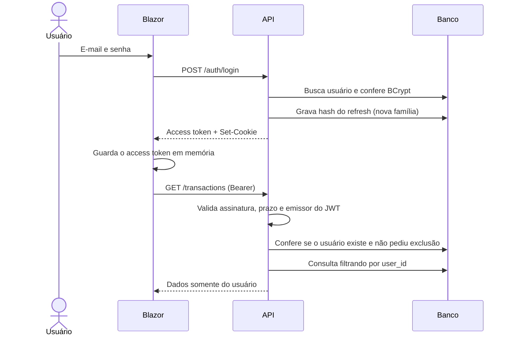
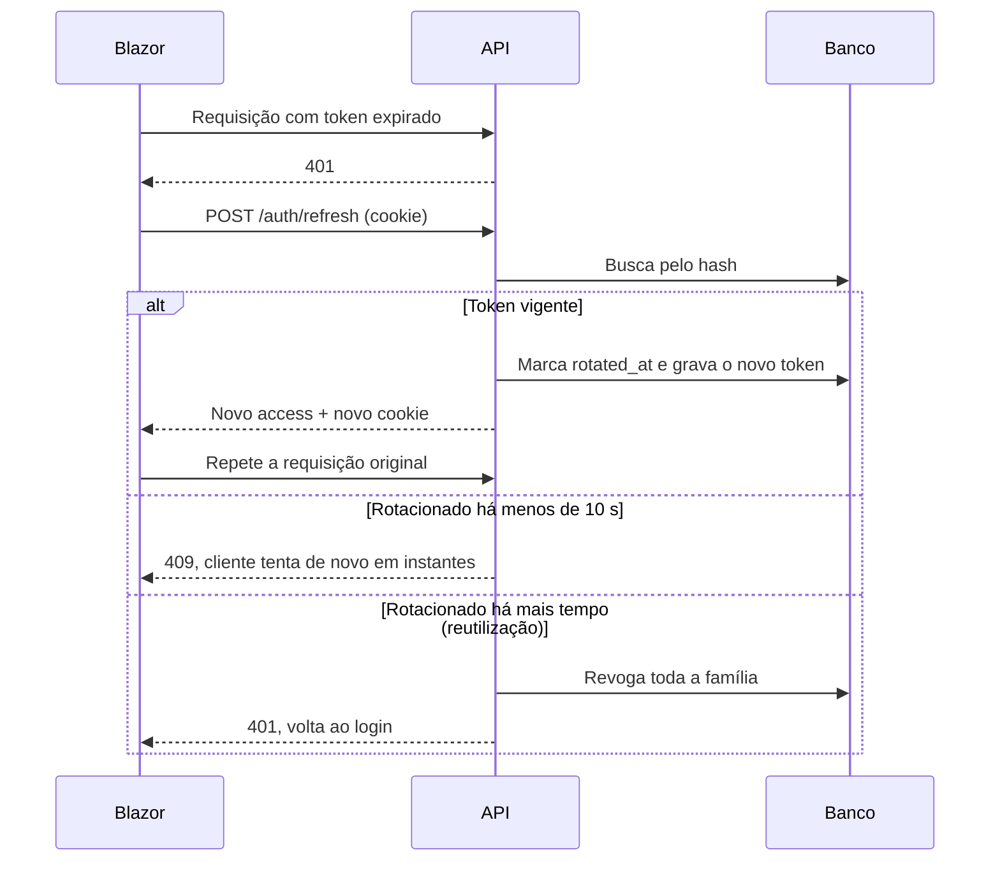

# 05 — Fluxo de autenticação

## Tokens

| Token | Formato | Validade | Onde fica |
|---|---|---|---|
| Access | JWT assinado (HS256; segredo em variável de ambiente) | 15 min | Memória do frontend |
| Refresh | Valor aleatório de 256 bits | 7 dias, renovados a cada rotação | Cookie; no banco, apenas o hash SHA-256 |

**Cookie:** `HttpOnly; Secure; SameSite=Strict; Path=/api/v1/auth`. O JavaScript não consegue lê-lo, e ele só é enviado às rotas de autenticação.

**Por que não `localStorage`:** qualquer XSS leria o token. Em memória, ele some ao recarregar a página, e por isso o app chama `/auth/refresh` ao iniciar.

**CSRF:** `SameSite=Strict`, a mesma origem e o uso de cookie apenas em `/auth/*` cobrem o risco. As demais rotas usam o header Bearer, que o navegador não envia sozinho.

**Desenvolvimento:** frontend e API rodam em portas diferentes, ou seja, em origens diferentes do mesmo site `localhost`. O CORS libera apenas a origem do frontend, com credenciais, e o `HttpClient` usa `SetBrowserRequestCredentials(Include)`. Os atributos do cookie são configuráveis por perfil.

## Login e uso

Login sem e-mail validado responde 403 com o código `EMAIL_NOT_VERIFIED`.

O access token de quem excluiu a conta ou pediu a exclusão é recusado com 401, sem esperar os 15 minutos de validade (`ActiveUserValidator`). A conferência só é feita depois que assinatura, prazo e emissor são aprovados, e custa uma consulta por chave primária a cada requisição.

## Renovação com rotação

**Janela de 10 s:** sem ela, duas abas renovando ao mesmo tempo seriam confundidas com roubo de token e derrubariam a sessão. No cliente, um único pedido de renovação por aba é compartilhado entre as requisições simultâneas.

## Logout

1. `POST /auth/logout` revoga a família do token atual.
2. A API limpa o cookie.
3. O frontend apaga o token da memória e redireciona ao login.

## Validação de e-mail e recuperação de senha

| Regra | Definição |
|---|---|
| Token | Aleatório, uso único, somente o hash no banco |
| Validade | Validação: 24 h; recuperação: 30 min |
| Enumeração | `register`, `forgot-password` e `resend-verification` respondem 202 de forma idêntica, com o e-mail existindo ou não |
| Efeito da nova senha | Revoga todas as sessões do usuário |
| Limite de tentativas | Login, cadastro e recuperação, por IP e por e-mail (429). Troca de senha, troca de e-mail e pedido de exclusão, por conta, com um contador comum às três rotas (429) |

## Senhas

BCrypt, fator 12; mínimo de 8 caracteres, máximo de 72 bytes (limite do algoritmo).

## Proteção de rotas

- **API:** tudo é negado por padrão, exceto `/auth/*` públicas e, fora de produção, o Swagger.
- **Frontend:** `[Authorize]` e `AuthorizeRouteView` melhoram a navegação, mas **a segurança real está na API**.
- **Isolamento:** o `userId` vem somente do JWT, e os testes do módulo verificam acesso cruzado entre usuários.
